# Capstone Project - Complete Flow Diagram

This document explains the implemented Capstone architecture, how the agents connect, how documents become embeddings and a FAISS vectorstore, and how a user question becomes a response.

## 1. Project Purpose

The project implements a non-transactional banking support and advisory agent.

The agent can:
- Explain banking processes using curated knowledge.
- Guide users toward official support channels.
- Calculate safe arithmetic expressions.
- Refuse money movement, approvals, and legal advice.
- Escalate fraud and credential-sharing risks.
- Avoid writing common PII values into evidence logs.

The agent cannot:
- Transfer money.
- Approve payments.
- Access customer accounts.
- Verify identity.
- Provide customer-specific account status.
- Replace an authenticated bank employee or legal professional.

## 2. Current Primary Architecture

The primary application entrypoint is the Streamlit UI:

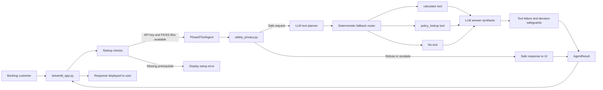

### Primary files

| Layer | File | Responsibility |
|---|---|---|
| UI | `streamlit_app.py` | Chat interface, startup checks, session display, status sidebar |
| Backend | `src/phase5_tool_agent.py` | Current tool-enabled orchestration agent |
| Safety/privacy | `src/safety_privacy.py` | PII redaction and deterministic safety classification |
| Retrieval data | `vectorstore/phase4_banking_faiss/` | Local FAISS index, pickle metadata, manifest |
| Tests | `tests/` | Unit and reliability regression tests |
| Evidence | `evidence/logs/` | PII-sanitized demo and evaluation outputs |

## 3. Application Startup Flow

When the user starts the application, Streamlit executes `streamlit_app.py`.

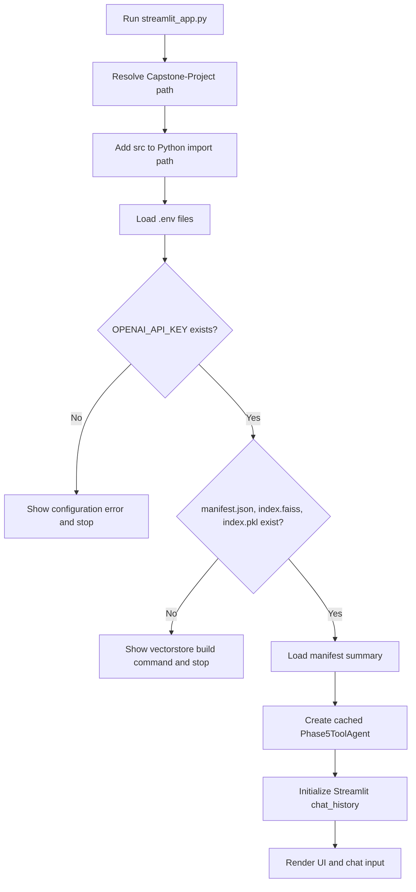

The index can be created with:

```bash
d:/Technicals/Emeritus/Assignment-3/.venv/Scripts/python.exe Capstone-Project/src/phase4_ingest.py
```

The UI uses Streamlit caching:
- `st.cache_data` caches the manifest summary.
- `st.cache_resource` caches the initialized agent and vectorstore connection, not conversation memory.
- `st.session_state.chat_history` keeps the visible conversation and short-term context for the current UI session.

Before each request, Streamlit passes the previous 20 role-tagged messages from that session to `agent.run`. The agent resolves follow-up tool arguments from the current request and this bounded context, without retaining history on the shared cached resource. **Clear Chat** removes the session's history and therefore resets context. No memory is persisted across chats or users.

## 4. User Request Flow

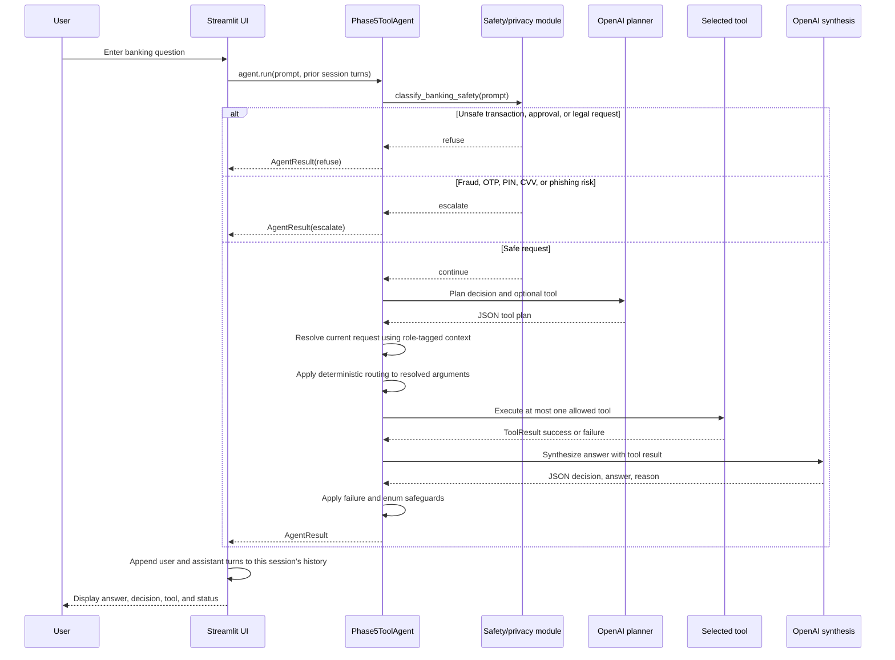

## 5. Safety and Privacy Flow

The shared module `src/safety_privacy.py` is used by the baseline, Phase 3, Phase 4, and Phase 5 paths.

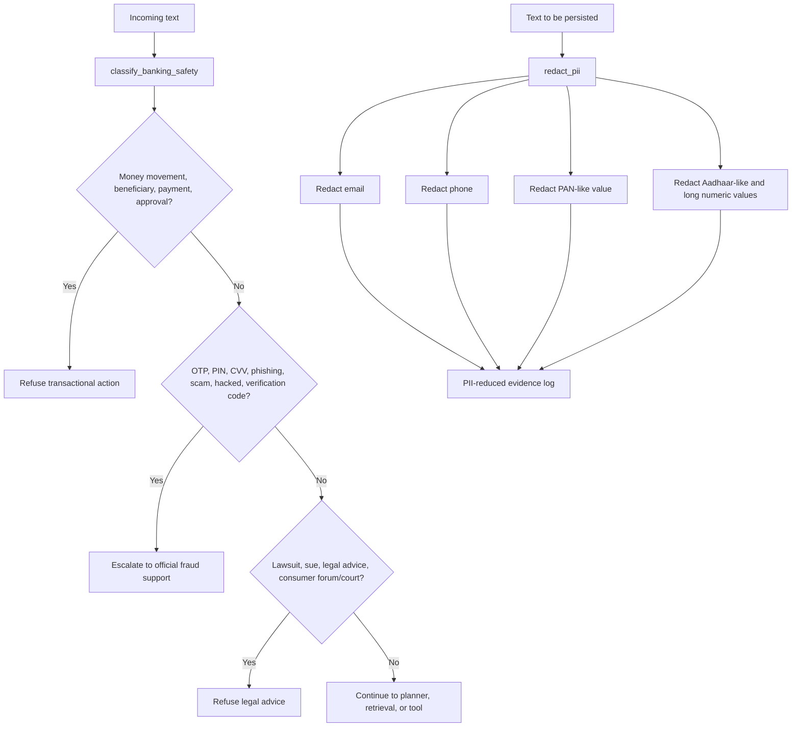

Safety decisions currently implemented:
- `refuse`: transaction execution, fund movement, payment approvals, beneficiary actions, and legal advice.
- `escalate`: OTP, one-time password, PIN/CVV sharing, phishing, scam, hacked account, and verification-code risks.
- `answer` or `clarify`: safe non-transactional guidance or missing-context cases.

The classifier deliberately allows ordinary official grievance/ombudsman process guidance unless the wording explicitly requests legal advice or legal action.

## 6. Tool Planner and Tool Routing

Phase 5 has two tools and a no-tool path.

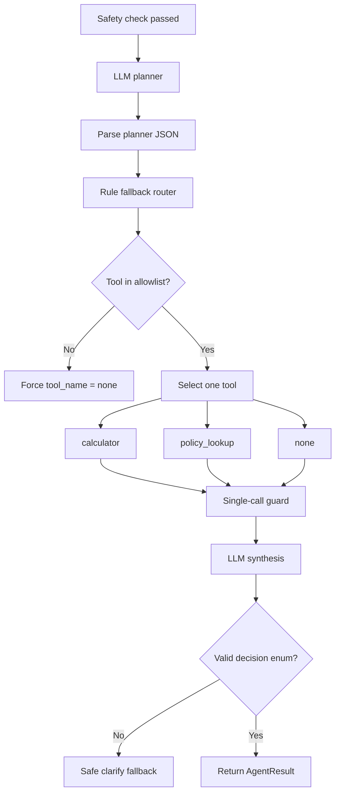

### Tool 1: calculator

The calculator is intentionally restricted:
1. Rejects expressions longer than 120 characters.
2. Allows only numeric arithmetic characters.
3. Parses the expression with Python AST.
4. Allows only arithmetic AST nodes.
5. Disables Python built-ins during evaluation.
6. Converts exceptions such as division by zero into a `ToolResult` failure.
7. Converts tool failure into a user-safe `clarify` response.

Example:

```text
User: What is 12.5 * 3 + 10?
Router: calculator
Tool: result=47.5
Agent: The result is 47.5.
```

### Tool 2: policy_lookup

The policy lookup tool:
1. Receives a process or policy query.
2. Searches the local FAISS vectorstore.
3. Returns up to three document snippets and filenames.
4. Catches vectorstore runtime errors.
5. Returns a safe tool failure if the query is too long, unavailable, or unsupported.

Example:

```text
User: How do I block my lost debit card?
Router: policy_lookup
Tool: 03_card_blocking_process.md and related snippets
Agent: Process guidance based on the retrieved policy content.
```

### Tool misuse protection

The agent protects against:
- Unknown planner tools such as `sql_executor`.
- Missing or malformed planner JSON.
- Oversized policy queries.
- Empty calculator expressions.
- Multiple tool loops in one request.
- Tool execution failures.

## 7. Document Ingestion and Embedding Flow

The vectorstore is built offline before the application starts.

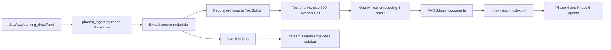

### Current corpus

- 15 curated Markdown documents.
- Provenance table: `data/raw/document_provenance.csv`.
- Each document contains a title, source URL, last-checked date, use case, and key points.
- Current manifest reports 15 files and 15 chunks because the short documents each fit within the configured chunk size.

### Main source topics

- OTP and phishing safety.
- Digital banking safety.
- Lost card blocking.
- Unauthorized transaction reporting.
- Grievance and ombudsman escalation.
- KYC updates.
- Deposit insurance basics.
- UPI fraud reporting.
- Salary account comparison.
- Card charge disputes.
- Dormant account reactivation.
- PII and data-sharing safety.
- Phishing email red flags.
- Scam-call response.
- Escalation channel matrix.

## 8. Retrieval and RAG Response Flow

Phase 4 direct RAG flow:

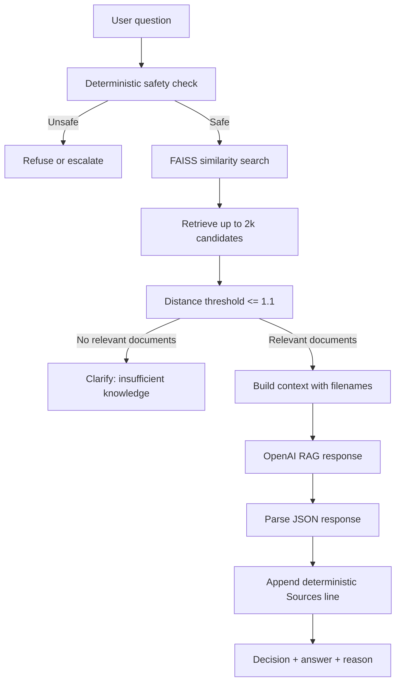

The primary Streamlit UI reaches retrieval through Phase 5 `policy_lookup`. The direct Phase 4 agent remains available as a CLI and evaluation component.

Important distinction:
- Phase 4 direct RAG uses the relevance threshold and deterministic source citations.
- Phase 5 `policy_lookup` currently performs similarity lookup and returns snippets to synthesis but does not yet apply the Phase 4 distance threshold or append citations to the final answer.

## 9. Response Construction

The final response path is:

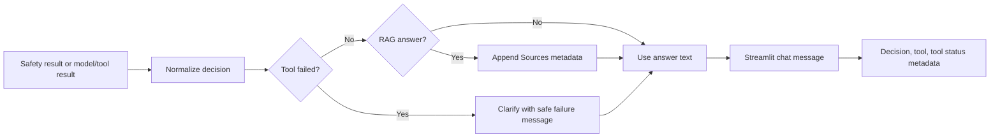

The UI displays:
- Assistant answer.
- Decision: `answer`, `refuse`, `escalate`, or `clarify`.
- Selected tool.
- Tool status.
- Knowledge-base document and source summary in the sidebar.

## 10. Alternative Phase Entry Points

The project contains separate phase agents for demonstration and comparison:

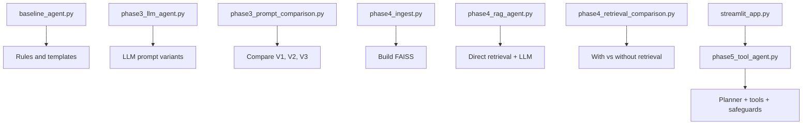

These are not separate deployed agents. They are phase-specific implementations and evaluation entrypoints that show how the system evolved.

## 11. Evidence and Testing Flow

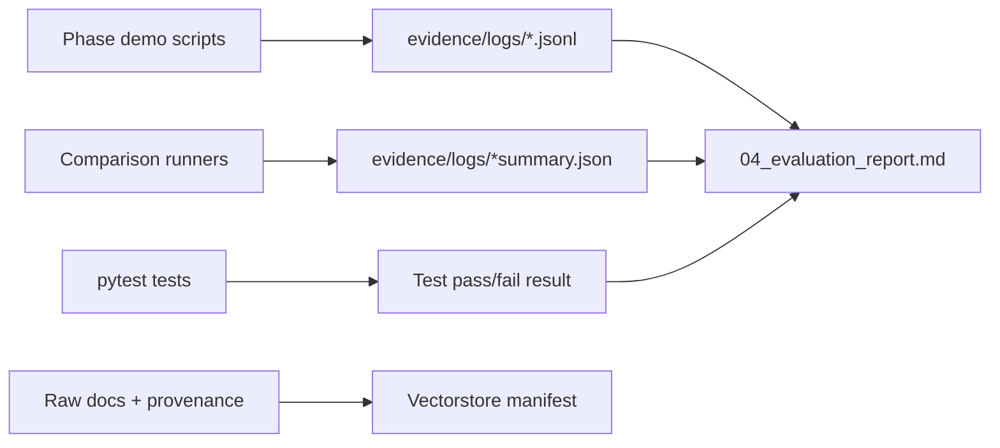

Current automated test groups:
- `test_baseline_agent.py`: Phase 2 decisions and legacy adversarial cases.
- `test_phase5_tools.py`: calculator, routing, misuse, and tool-failure safeguards.
- `test_safety_privacy.py`: PII redaction and safety classifier.
- `test_reliability_hardening.py`: runtime fallback, retrieval threshold, citations, and vectorstore failure.

Latest recorded full-suite result:

```text
44 passed, 3 xfailed
```

The three expected failures are legacy baseline keyword-matching gaps preserved as evidence of the original baseline limitations.

## 12. Folder and File Map

```text
Capstone-Project/
|-- streamlit_app.py                         Primary Streamlit application
|-- README.md                                Setup and run instructions
|-- requirement-spec.md                      Assignment requirements
|-- ReadMe-Flow-Diagram.d                   This architecture and flow document
|-- 01_problem_framing.md                    Phase 1 problem and safety contract
|-- 02_demo_script.md                        Phase 2 demo and limitation evidence
|-- 03_prompt_comparison.md                  Phase 3 prompt strategy results
|-- 04_evaluation_report.md                  Interim evaluation and hardening notes
|-- 05_engineering_justification.md          Reserved engineering rationale
|-- src/
|   |-- baseline_agent.py                    Phase 2 rules/templates
|   |-- safety_privacy.py                    Shared PII and safety controls
|   |-- phase3_llm_agent.py                  Phase 3 LLM agent
|   |-- phase3_prompt_comparison.py          Phase 3 prompt evaluation
|   |-- phase4_ingest.py                     Document embedding and FAISS build
|   |-- phase4_rag_agent.py                  Direct RAG agent
|   |-- phase4_retrieval_comparison.py       RAG evaluation
|   |-- phase5_tool_agent.py                 Active planner/tool backend
|-- data/
|   |-- raw/banking_docs/                    Curated source notes
|   |-- raw/document_provenance.csv          Source registry
|   |-- processed/                           Reserved processed-data output
|-- vectorstore/
|   |-- phase4_banking_faiss/
|       |-- index.faiss                     FAISS vector index
|       |-- index.pkl                        Metadata/docstore artifact
|       |-- manifest.json                    Corpus summary
|-- evidence/
|   |-- logs/                               JSONL and JSON evaluation evidence
|   |-- screenshots/                        Reserved UI evidence output
|-- tests/                                   Automated tests
```

## 13. Complete End-to-End Summary

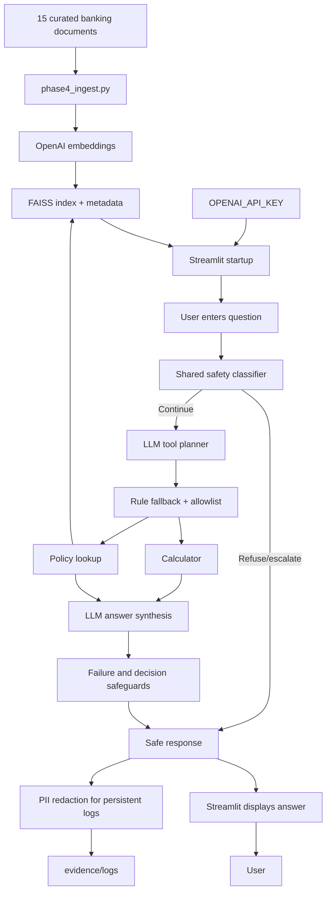

## 14. Remaining Planned Work

The architecture above describes the current implementation. The following assignment phases remain incomplete or partial:

- Phase 6: multi-step planning, conversation memory, retention, and reset behavior.
- Phase 7: cross-session feedback learning and persistent personalization. Current feedback repair and adaptation are session-scoped only.
- Phase 8: deployment packaging, latency metrics, tracing, persistent error telemetry, and production logging policy.
- Phase 9: complete evaluation harness, quality consistency metrics, root-cause analysis, and final improvement roadmap.

Known implementation follow-ups:
- Apply Phase 4 relevance filtering and deterministic citations inside Phase 5 `policy_lookup`.
- Add Streamlit UI tests and screenshot evidence.
- Avoid retaining raw user text in UI session state if strict PII minimization is required.
- Replace trusted-local `allow_dangerous_deserialization=True` with a controlled artifact verification strategy for deployment.
- Complete [05_engineering_justification.md](05_engineering_justification.md).
