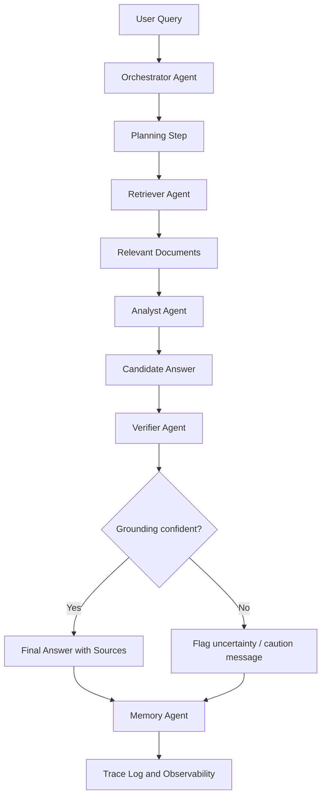

# Agent Architecture and Flow

## System design

The Enterprise Knowledge Ops Agent is structured as a coordinated multi-agent workflow designed for grounded enterprise question answering.

## Agent responsibilities

| Agent | Primary role | Output |
|---|---|---|
| Orchestrator | Plans the query workflow and routes tasks | Execution plan |
| Retriever | Finds relevant policy and document evidence | Ranked source documents |
| Analyst | Synthesizes findings into a candidate answer | Reasoned answer with citations |
| Verifier | Checks whether the answer is grounded in evidence | Pass/fail with confidence score |
| Memory | Keeps the conversational context | Prior Q&A context |

## Execution flow

## Why this architecture fits the assignment

This architecture reflects the case-study expectation that enterprise AI should not behave like a single reactive chatbot. Instead, it should:

- break down complex multi-document questions
- route subtasks to expert capabilities
- maintain source grounding
- provide explainability through trace logs
- apply guardrails before final output

## Observability and traceability

The implementation exposes the following traces:

- orchestration plan
- retrieval sources and relevance
- reasoning summary
- validation outcome
- grounding confidence score

These traces help developers and reviewers understand how the final answer was formed.

## Local implementation summary

The current project implements this architecture in Python with a lightweight rule-based agent framework and a Streamlit interface. It is intentionally local and focused on correctness rather than cloud-scale deployment.
